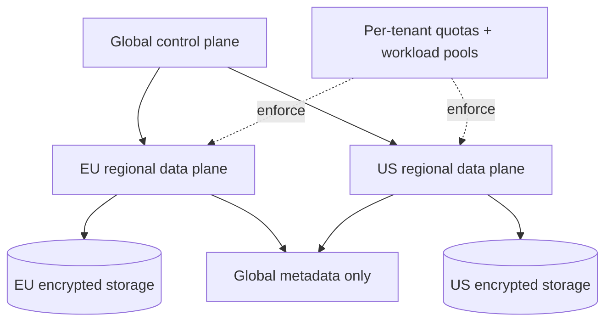

# Data Architecture: Global Multi-Tenant Platform

## Topic explanation

Multi-tenant architecture must isolate security, performance, cost, and failure while preserving operability. Residency constrains placement; RPO/RTO constrain replication; noisy-neighbor risk constrains compute sharing. Control planes manage metadata and policy, while data planes move customer data.



## Practical example and analogy

An apartment building shares structure but not door keys, utility bills, or fire compartments. Tenant isolation is more than separate nameplates on the same database.

## Code exercise

Implement `design_platform(requirements)`. Produce regional placement, tenancy model, capacity with headroom, workload isolation, encryption/key strategy, failover, RPO/RTO, observability, and monthly cost. Detect contradictory residency and failover requirements. Calculate peak events per second from daily volume and peak factor.

## AI review

Use `AI_REVIEW_PROMPT.md`; defend failure domains, metadata boundaries, and cost allocation.

## Unit test

```bash
pytest advanced/01-data-architecture/tests -q
```
