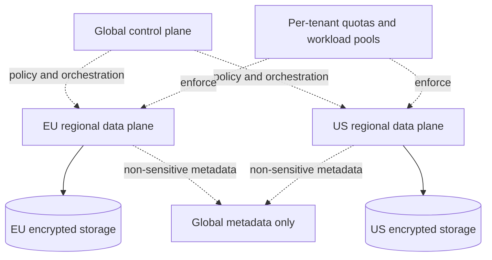

# Data Architecture: Global Multi-Tenant Platform

## Topic explanation

Multi-tenant architecture must isolate security, performance, cost, and failure while preserving operability. Residency constrains placement; recovery point objective (RPO)/recovery time objective (RTO) constrain replication; noisy-neighbor risk constrains compute sharing. Control planes manage metadata and policy, while data planes move customer data.

**Analogy:** An apartment building shares structure but not door keys, utility bills, or fire compartments. Tenant isolation is more than separate nameplates on one database.



## Solved practical example

At 8.64 billion events/day, average load is 100,000 events/s. A 4× peak and 30% headroom require at least 520,000 events/s provisioned capacity. Route European Union (EU) tenant payloads only through an EU data plane and EU-managed keys; replicate global metadata without personally identifiable information (PII). Use per-tenant queues, quotas, workload pools, and cost tags. An availability-zone failure can fail over inside the same EU region. A full regional failure requires a second approved EU region; it must not fail over to the United States (US) when residency rules prohibit that transfer.

## Code exercise

Implement `design_platform(requirements)`. Produce regional placement, tenancy model, capacity with headroom, workload isolation, encryption/key strategy, failover, RPO/RTO, observability, and monthly cost. Detect contradictory residency and failover requirements. Calculate peak events per second from daily volume and peak factor.

### Homework contract

Inputs include daily event count, peak multiplier, headroom fraction, available regions, an EU-residency flag, recovery targets, tenant count, and budget. Compute `peak_events_per_second = daily_events / 86_400 * peak_factor`, then provision at least `peak * (1 + headroom)`.

Capacity and cost examples use terabytes (TB) when storage volume is expressed in `history_tb` or similar fields.

Return `peak_events_per_second`, `provisioned_events_per_second`, `regional_placement`, `tenancy_model`, at least four `isolation_controls`, encryption/key policy, `failover`, `observability`, and `estimated_monthly_cost`. The failover object must repeat achievable RPO/RTO values. If EU data must remain in the EU but no approved EU region exists, or the design cannot fit the budget, raise `ValueError` rather than violating a hard requirement.

Recovery point objective (RPO), recovery time objective (RTO), peak factor, and tenant count must be positive; daily volume and headroom cannot be negative. Tenant count must influence cost or capacity. Do not claim regional failover readiness unless at least two approved regions exist in that jurisdiction: with only one European Union (EU) region, return an explicit “not configured” gap and `regional_failover_ready.eu = false`.

### Example input and expected output

```python
requirements = {
    "daily_events": 86_400_000,
    "peak_factor": 3,
    "headroom": 0.25,
    "regions": ["us", "eu"],
    "eu_must_stay_eu": True,
    "rpo_minutes": 10,
    "rto_minutes": 45,
    "tenants": 80,
    "budget": 50_000,
}
```

Required numeric results are a 3,000 event/second peak and at least 3,750 provisioned events/second. The remaining output should resemble:

```python
{
    "regional_placement": {"eu": "eu", "us": "us"},
    "isolation_controls": ["per-tenant queues", "quotas", "workload pools", "cost tags"],
    "failover": {"rpo_minutes": 10, "rto_minutes": 45, "eu": "another approved EU region"},
    "estimated_monthly_cost": 20_000,
    # tenancy, encryption, observability, and calculated capacity fields
}
```

Cost formulas may differ, but assumptions and feasibility must be defensible.

## Artificial Intelligence (AI) review

Use `AI_REVIEW_PROMPT.md`; defend failure domains, metadata boundaries, and cost allocation.

## Unit test

```bash
pytest advanced/01-data-architecture/tests -q
```
