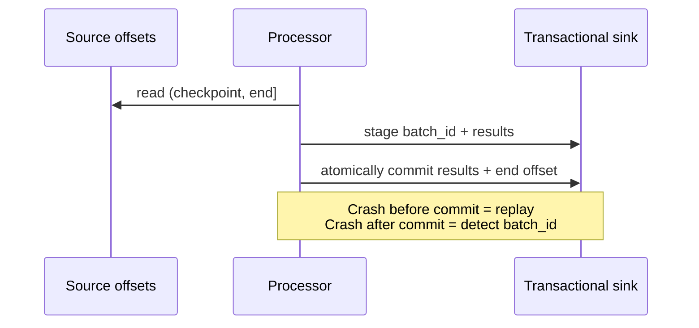

# Processing and Orchestration: Distributed Correctness

## Topic explanation

Exactly-once is an end-to-end property, not a checkbox. Sources need stable offsets, transforms need deterministic semantics, sinks need idempotent or transactional commits, and checkpoints must align with published output. Backpressure protects the system by bounding admitted work.

**Analogy:** Paying a bill and updating the checkbook must be one recoverable action. If a crash occurs between them, the payment identifier—not hope—prevents double payment.



## Solved practical example

Checkpoint 100 and capacity 2 receive offsets 101–105. Deterministic batches are `[101,102]`, `[103,104]`, and `[105]`; each batch identifier (ID) hashes its offset range and input IDs. A sink transaction writes outputs and the end offset together. If batch 2 times out after commit, recovery finds its batch ID and skips it. If it timed out before commit, the same deterministic batch is safe to replay.

## Code exercise

Implement `recover_and_plan(events, committed_batches, checkpoint, capacity)`. Ignore committed event IDs, order source offsets, split deterministic bounded batches, reject offset conflicts, and attach an atomic commit record containing batch ID, offset range, input hash, and output IDs.

### Homework contract

Each event has a unique `event_id`, numeric source `offset`, and payload. A committed batch exposes at least `output_ids` and an ending offset. Return a dictionary containing the current `checkpoint` and ordered `batches`. Do not mutate or materialize a different result when input order changes.

Reject nonpositive capacity, negative or non-integer offsets, one offset claimed by distinct events, and one `event_id` appearing at multiple offsets. Exact duplicate identities collapse to one event; the same `(offset, event_id)` with different content is a hard conflict. Treat the greatest committed ending offset as part of the effective checkpoint, even if the supplied checkpoint is stale. Exclude events already committed or at/below that effective checkpoint. Split the remainder into batches of at most `capacity`. Every batch contains a deterministic `batch_id`, `start_offset`, `end_offset`, `input_hash`, and ordered `output_ids`; hashes must cover canonical input content, not Python object identity.

### Example input and expected output

```python
events = [
    {"event_id": "e12", "offset": 12, "value": "b"},
    {"event_id": "e11", "offset": 11, "value": "a"},
    {"event_id": "e13", "offset": 13, "value": "c"},
]
result = recover_and_plan(events, committed_batches=[], checkpoint=10, capacity=2)
```

Expected structure:

```python
{
    "checkpoint": 10,
    "batches": [
        {
            "start_offset": 11, "end_offset": 12,
            "output_ids": ["e11", "e12"],
            "batch_id": "<deterministic hash>", "input_hash": "<deterministic hash>",
            # atomic commit description
        },
        {
            "start_offset": 13, "end_offset": 13,
            "output_ids": ["e13"],
            "batch_id": "<deterministic hash>", "input_hash": "<deterministic hash>",
        },
    ],
}
```

## Artificial Intelligence (AI) review

Use `AI_REVIEW_PROMPT.md`; explain crash points, poison records, and what “exactly once” means to the business.

## Unit test

```bash
pytest advanced/03-processing-and-orchestration/tests -q
```
