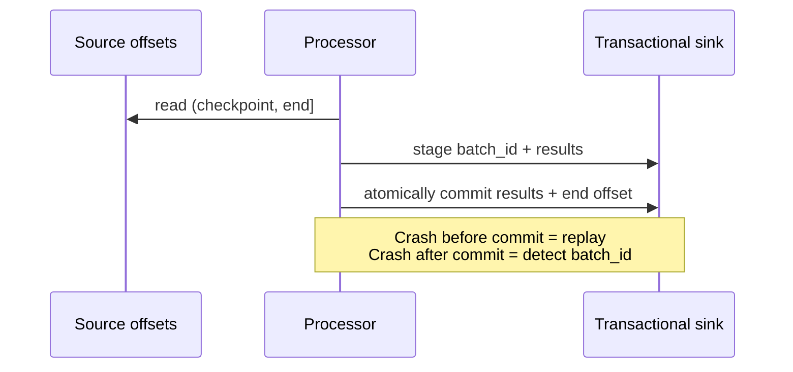

# Processing and Orchestration: Distributed Correctness

## Topic explanation

Exactly-once is an end-to-end property, not a checkbox. Sources need stable offsets, transforms need deterministic semantics, sinks need idempotent or transactional commits, and checkpoints must align with published output. Backpressure protects the system by bounding admitted work.



## Practical example and analogy

Paying a bill and updating the checkbook must be one recoverable action. If a crash happens between them, the payment identifier—not hope—prevents double payment.

## Code exercise

Implement `recover_and_plan(events, committed_batches, checkpoint, capacity)`. Ignore committed event IDs, order source offsets, split deterministic bounded batches, reject offset conflicts, and attach an atomic commit record containing batch ID, offset range, input hash, and output IDs.

## AI review

Use `AI_REVIEW_PROMPT.md`; explain crash points, poison records, and what “exactly once” means to the business.

## Unit test

```bash
pytest advanced/03-processing-and-orchestration/tests -q
```
