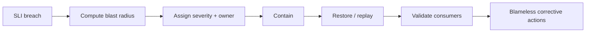

# DataOps: SLOs, Incidents, and Recovery

## Topic explanation

An SLO defines consumer-visible reliability; an error budget controls change velocity. Incident response prioritizes impact, containment, communication, restoration, and learning. Lineage turns a failed asset into a blast radius. Disaster recovery is credible only when restored data is validated through exercises.

**Analogy:** An SLO is a household circuit breaker, not a promise that electricity never fails. It defines tolerable failure and stops risky changes after the budget is consumed.



## Solved practical example

A 99.9% monthly SLO allows about 43.2 bad minutes. A 90-minute freshness incident therefore burns 2.08 monthly budgets. Lineage shows the affected raw table feeds a regulatory Finance report, so declare SEV-1/2 according to company policy, freeze deployments, stop the corrupt producer, communicate every 30 minutes, replay from the last verified offset, and validate Finance totals before closure. Twenty broken sandboxes alone would not justify the same severity.

## Code exercise

Implement `assess_incident(asset, observed, slo, lineage)`. Calculate error-budget burn, transitive critical consumers, severity, immediate actions, communication cadence, replay boundary, and whether deployments freeze. Avoid upgrading severity solely because many noncritical assets exist.

## AI review

Use `AI_REVIEW_PROMPT.md`; run a live incident with incomplete and changing evidence.

## Unit test

```bash
pytest advanced/05-dataops/tests -q
```
