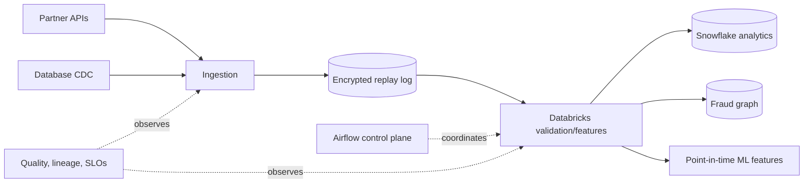

# Capstone: Intelligent Commerce Data Platform

## Topic explanation and scenario

A LATAM/US retailer needs a platform for analytics, fraud graph exploration, and ML features. It receives API and CDC data, peaks at 250,000 events/second, contains PII, requires EU residency, 15-minute analytics freshness, sub-second fraud lookups, 99.9% availability, replay for 30 days, and controlled cost. The preferred stack includes AWS, Databricks, Snowflake, Airflow, and optionally Neo4j.



## Code exercise

You have 180 minutes:

1. Complete `DESIGN.md`: requirements, diagram, capacity math, storage/modeling choices, security, SLOs, failure recovery, cost controls, migration, and rejected alternatives.
2. Implement `process_batch` in `homework.py`: schema validation, deduplication by latest source version, PII tokenization, tombstones, quarantine, deterministic output, and metrics.
3. Run tests and record output in `DESIGN.md`.
4. Give a 10-minute architecture presentation, 20-minute challenge, and 20-minute live-code extension.

## Practical example and analogy

Treat the platform as an international airport: regional laws control where passengers may go, baggage tags provide lineage, security gates enforce contracts, runways impose capacity, and the control tower coordinates without carrying passengers itself.

## AI review

Use `AI_REVIEW_PROMPT.md` only after the time box. It runs the complete mock interview.

## Unit test

```bash
pytest advanced/08-capstone-mock-interview/tests -q
```
