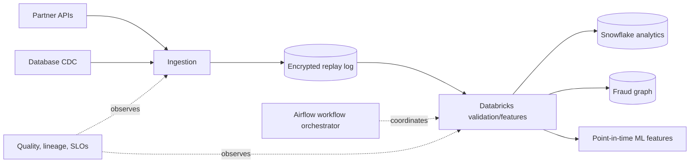

# Capstone: Intelligent Commerce Data Platform

## Topic explanation and scenario

A Latin America (LATAM)/United States (US) retailer needs a platform for analytics, fraud graph exploration, and machine learning (ML) features. It receives application programming interface (API) and change data capture (CDC) data, peaks at 250,000 events/second, contains personally identifiable information (PII), requires European Union (EU) residency, 15-minute analytics freshness, sub-second fraud lookups, 99.9% availability, replay for 30 days, and controlled cost. The preferred stack includes Amazon Web Services (AWS), Databricks, Snowflake, Airflow, and optionally Neo4j.

**Analogy:** Treat the platform as an international airport: regional laws control where passengers may go, baggage tags provide lineage, security gates enforce contracts, runways impose capacity, and the control tower coordinates without carrying passengers itself.



## Solved practical example

For one narrow subproblem—safe retries of customer updates—use `(customer_id, source_version)` as the ordering rule, `event_id` for replay detection, and a deterministic Keyed-Hash Message Authentication Code (HMAC) pseudonym for normalized email. Given existing version 5, an arriving version 4 is counted as stale; a version 6 tombstone removes the customer; replaying both leaves the same result. Metrics report two inputs, one stale event, one deletion, and zero raw emails. The pseudonym still counts as personal data: it reveals equality, requires protected and rotatable keys, and is not encryption or anonymization. This solved pattern informs the capstone but does not solve its architecture or full batch processor.

## Code exercise

You have 180 minutes:

1. Complete `DESIGN.md`: requirements, diagram, capacity math, storage/modeling choices, security, service-level objectives (SLOs), failure recovery, cost controls, migration, and rejected alternatives.
2. Implement `process_batch` in `homework.py`: schema validation, deduplication by latest source version, keyed PII pseudonymization with normalized inputs, tombstones, quarantine, deterministic output, and metrics. Document key versioning and rotation; never describe pseudonymized data as anonymous.
3. Run tests and record output in `DESIGN.md`.
4. Give a 10-minute architecture presentation, 20-minute challenge, and 20-minute live-code extension.

## Artificial Intelligence (AI) review

Use `AI_REVIEW_PROMPT.md` only after the time box. It runs the complete mock interview.

## Unit test

```bash
pytest advanced/08-capstone-mock-interview/tests -q
```
