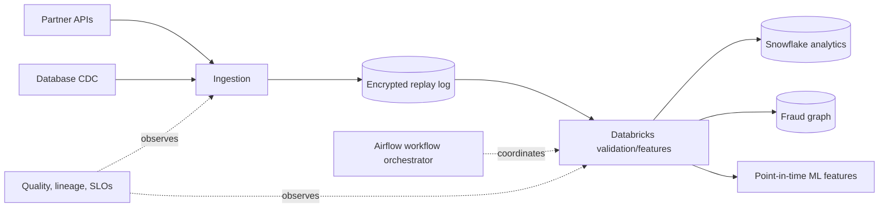

# Capstone: Intelligent Commerce Data Platform

## Topic explanation and scenario

A Latin America (LATAM)/United States (US) retailer needs a platform for analytics, fraud graph exploration, and machine learning (ML) features. It receives application programming interface (API) and change data capture (CDC) data, peaks at 250,000 events/second, contains personally identifiable information (PII), requires European Union (EU) residency, 15-minute analytics freshness, sub-second fraud lookups, 99.9% availability, replay for 30 days, and controlled cost. The preferred stack includes Amazon Web Services (AWS), Databricks, Snowflake, Airflow, and optionally Neo4j.

**Analogy:** Treat the platform as an international airport: regional laws control where passengers may go, baggage tags provide lineage, security gates enforce contracts, runways impose capacity, and the control tower coordinates without carrying passengers itself.



## Solved practical example

For one narrow subproblem—safe retries of customer updates—use `(customer_id, source_version)` as the ordering rule, `event_id` for replay detection, and a deterministic Keyed-Hash Message Authentication Code (HMAC) pseudonym for normalized email. Given existing version 5, an arriving version 4 is counted as stale; a version 6 tombstone removes the customer; replaying both leaves the same result. Metrics report two inputs, one stale event, one deletion, and zero raw emails. The pseudonym still counts as personal data: it reveals equality, requires protected and rotatable keys, and is not encryption or anonymization. This solved pattern informs the capstone but does not solve its architecture or full batch processor.

## Code exercise

You have 180 minutes:

1. Complete `DESIGN.md`: requirements, diagram, capacity math, storage/modeling choices, security, service-level objectives (SLOs), failure recovery, cost controls, migration, and rejected alternatives.
2. Implement `process_batch` in `homework.py`: schema validation, deduplication by latest source version, keyed PII pseudonymization with normalized inputs, tombstones, quarantine, deterministic output, and metrics. Document key versioning and rotation; never describe pseudonymized data as anonymous.
3. Run tests and record output in `DESIGN.md`.
4. Give a 10-minute architecture presentation, 20-minute challenge, and 20-minute live-code extension.

### Expected deliverables

`DESIGN.md` should be at least 900 words and must quantify throughput, headroom, storage, recovery point objective (RPO), recovery time objective (RTO), freshness, and cost assumptions. Include a Mermaid diagram and cover regional placement, ingestion, raw replay, Databricks processing, Snowflake serving, graph projection, feature correctness, security, observability, migration, rollback, and rejected alternatives. Record the actual test command and result.

`process_batch(existing, events, pii_secret)` must return `published`, durable `state`, `tombstones`, `quarantined`, and `metrics` without mutating inputs. `existing` may be the initial visible-row mapping or `result["state"]` from a previous call. Events contain nonempty `event_id`, entity `id`, `op`, and nonnegative exact-integer `source_version`. Upserts additionally require valid email and finite numeric amount; deletes do not. Order versions per entity, reject malformed rows, ignore stale or exact-replayed versions, quarantine identifier/version conflicts, apply durable tombstones, and produce deterministic output independent of event order.

Published rows must contain an `email_token` but no raw email key or value. Generate the token with a keyed cryptographic message-authentication construction over a normalized email. Changing the secret must change the token. In the design, explain secret storage, key versioning, rotation, equality leakage, and why the result remains personal data.

Persist a per-entity version watermark and processed-event fingerprint in `state`. Pass that full state into later batches: a visible-row snapshot alone cannot remember deleted versions and therefore cannot prevent stale resurrection. Include `email_token_version`; if initial rows contain raw email, tokenize and remove it before returning any output. The reference convention accepts `v2:key-material` to publish version `v2`; an unprefixed classroom secret is treated as `v1`. In production, pass the key identifier separately from secret material through a secrets manager rather than encoding both in one string.

### Example input and expected output

```python
existing = {
    "a": {"id": "a", "source_version": 1, "email_token": "old", "amount": 5}
}
events = [
    {"event_id": "e2", "id": "a", "op": "upsert", "source_version": 2, "email": " Ada@Example.com ", "amount": 7},
    {"event_id": "e3", "id": "b", "op": "upsert", "source_version": 1, "amount": "invalid"},
]
result = process_batch(existing, events, "local-test-secret")
```

Expected properties:

```python
result["published"]["a"]["source_version"] == 2
result["published"]["a"]["amount"] == 7
bool(result["published"]["a"]["email_token"]) is True
result["published"]["a"]["email_token_version"] == "v1"
"email" not in result["published"]["a"]
len(result["quarantined"]) == 1
result["metrics"]["input_count"] == 2
result["state"]["records"] == result["published"]
```

Running `process_batch(result["state"], events, "local-test-secret")` must leave `published` unchanged. Reversing the original input list against the same original state must produce the same complete result, including metrics and quarantine order.

### Delivery sequence

Present requirements and capacity first, then walk the data flow and regional boundaries. Defend one hard correctness invariant, one failure recovery, one cost trade-off, and one rejected alternative. During live coding, narrate validation and ordering before typing. Finish with test evidence and one limitation you would address before production.

## Artificial Intelligence (AI) review

Use `AI_REVIEW_PROMPT.md` only after the time box. It runs the complete mock interview.

## Unit test

```bash
pytest advanced/08-capstone-mock-interview/tests -q
```
