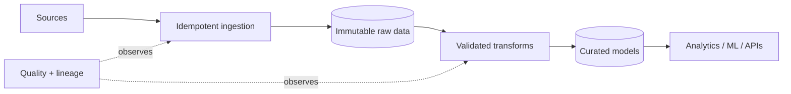

# Data Architecture: Requirements Drive Boxes

## Topic explanation

Architecture begins with workload and guarantees, not a favorite service. Establish volume, velocity, consumers, freshness, correctness, retention, security, recovery objectives, team skills, and budget. Separate ingestion, durable storage, transformation, serving, and control-plane concerns.

**Analogy:** A data platform resembles a water system: pipe diameter is throughput, tanks provide buffering, filters enforce quality, and meters provide observability. Pumps chosen before demand is known add cost without reliability.



## Solved practical example

Given 400 GB/day, six-hour freshness, seven-year retention, replay requirements, and no PII, a suitable answer is: hourly batch ingestion → immutable object-storage raw layer partitioned by ingestion date → validated columnar transformations → curated warehouse tables. Keep batch manifests and checksums for replay, use a six-hour RPO and four-hour RTO, and compact small files daily. Streaming is unjustified because the freshness requirement is hours, not seconds.

## Code exercise

Implement `design_pipeline(requirements)` in `homework.py`. Return a plan containing layers, delivery mode, partition key, recovery strategy, RPO/RTO, and explicit assumptions. It must react to freshness, replay, PII, and daily-volume constraints rather than return one static architecture.

Stretch: explain when your batch design should become streaming and why micro-batch may still win.

## AI review

Use `AI_REVIEW_PROMPT.md`. Be ready to defend one rejected architecture and estimate peak throughput.

## Unit test

```bash
pytest basics/01-data-architecture/tests -q
```
