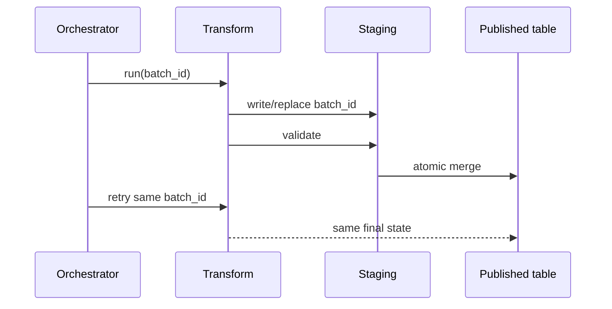

# Processing and Orchestration: Safe to Run Twice

## Topic explanation

An extract, transform, and load (ETL) task is production-ready when retries do not corrupt results. Prefer deterministic transformations, stable business keys, checkpoints outside ephemeral workers, atomic publication, and explicit handling for malformed records. An orchestrator coordinates work; it should not hide business logic inside a directed acyclic graph (DAG) file.

**Analogy:** Idempotency is an elevator button: pressing it repeatedly should not summon multiple elevators. A retry is expected control flow, not a second business event.



## Solved practical example

Existing state contains event `a`, amount 2, version time 10:00. A retry batch contains `a`, amount 3, version time 11:00 twice, plus `b`, amount −1. The solved result publishes only `a` with amount 3 and quarantines `b` with reason `negative_amount`. Reprocessing that batch produces the identical published state because `event_id` and version determine the merge.

## Code exercise

Implement `process_events(existing, incoming)`. Deduplicate by `event_id`, keep the record with the newest `updated_at`, reject invalid amounts, normalize currency casing, and return deterministic output. Reprocessing the same input must not change the result.

### Homework contract

Both arguments are lists of event dictionaries. A valid event has a nonempty `event_id`, a nonnegative numeric `amount`, a three-letter `currency`, and an `updated_at` timestamp in a consistently sortable format. Return `{"published": [...], "rejected": [...]}` without changing either input list or its dictionaries.

Combine existing and incoming data by business key. The newest timestamp wins; an exact retry must not create another row. If two different payloads for one `event_id` share the newest timestamp, raise `ValueError` because no truthful winner exists. Normalize valid currency codes such as United States dollar (USD) and euro (EUR) to uppercase. Timestamps must use the International Organization for Standardization (ISO) 8601 format and include a timezone. Boolean, negative, infinite, and not-a-number amounts are invalid. Add a readable `reason` to quarantined rows, and order both outputs deterministically so reversing input order does not change the business result.

### Example input and expected output

```python
existing = [
    {"event_id": "a", "amount": 5, "currency": "USD", "updated_at": "2026-01-01T10:00:00Z"}
]
incoming = [
    {"event_id": "a", "amount": 7, "currency": "usd", "updated_at": "2026-01-01T11:00:00Z"},
    {"event_id": "b", "amount": -2, "currency": "EUR", "updated_at": "2026-01-01T11:00:00Z"},
]
```

Expected business result:

```python
{
    "published": [
        {"event_id": "a", "amount": 7, "currency": "USD", "updated_at": "2026-01-01T11:00:00Z"}
    ],
    "rejected": [
        {"event_id": "b", "amount": -2, "currency": "EUR", "updated_at": "2026-01-01T11:00:00Z", "reason": "..."}
    ],
}
```

## Artificial Intelligence (AI) review

Use `AI_REVIEW_PROMPT.md`; expect questions about partial writes, retries, backfills, and task boundaries.

## Unit test

```bash
pytest basics/03-processing-and-orchestration/tests -q
```
