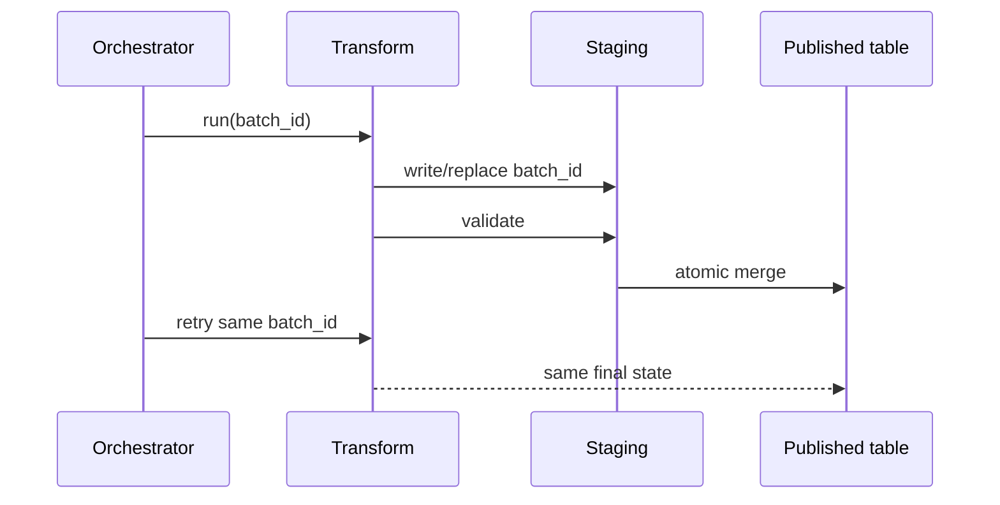

# Processing and Orchestration: Safe to Run Twice

## Topic explanation

An ETL task is production-ready when retries do not corrupt results. Prefer deterministic transformations, stable business keys, checkpoints outside ephemeral workers, atomic publication, and explicit handling for malformed records. An orchestrator coordinates work; it should not hide business logic inside a DAG file.

**Analogy:** Idempotency is an elevator button: pressing it repeatedly should not summon multiple elevators. A retry is expected control flow, not a second business event.



## Solved practical example

Existing state contains event `a`, amount 2, version time 10:00. A retry batch contains `a`, amount 3, version time 11:00 twice, plus `b`, amount −1. The solved result publishes only `a` with amount 3 and quarantines `b` with reason `negative_amount`. Reprocessing that batch produces the identical published state because `event_id` and version determine the merge.

## Code exercise

Implement `process_events(existing, incoming)`. Deduplicate by `event_id`, keep the record with the newest `updated_at`, reject invalid amounts, normalize currency casing, and return deterministic output. Reprocessing the same input must not change the result.

## AI review

Use `AI_REVIEW_PROMPT.md`; expect questions about partial writes, retries, backfills, and task boundaries.

## Unit test

```bash
pytest basics/03-processing-and-orchestration/tests -q
```
