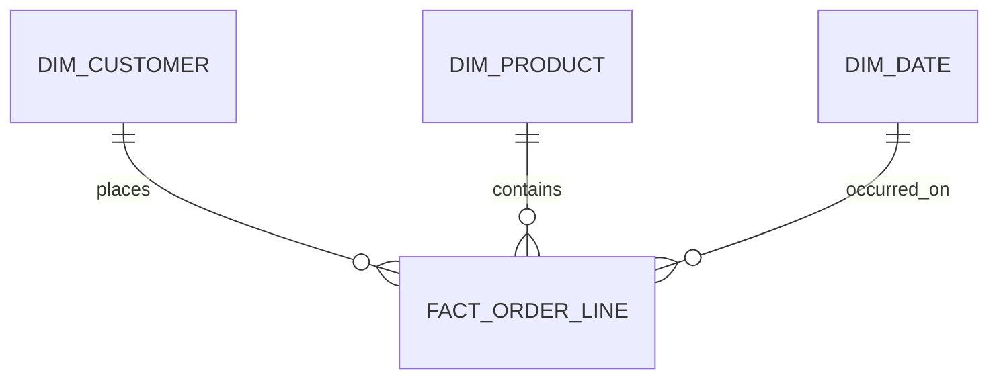

# Data Modeling: State the Grain First

## Topic explanation

The grain defines what one fact row represents. Dimensions provide descriptive context; facts provide additive or semi-additive measurements. Keys, late-arriving data, unknown members, and history rules must be explicit. A model that cannot answer its target questions simply is not “normalized” or “denormalized” correctly—it is misfit.



## Practical example and analogy

The grain is the unit printed on a measuring cup. Mixing “one order” and “one order line” in the same fact table is like mixing liters and individual bottles without a conversion rule.

## Code exercise

Implement `build_star_schema(order_lines)`. Create deterministic surrogate keys, three dimensions, and a fact table at **one row per order line**. Repeated customer/product attributes must not be copied into facts. Preserve an unknown member for missing customer IDs.

## AI review

Use `AI_REVIEW_PROMPT.md`; explain additive measures and how the model handles late-arriving dimensions.

## Unit test

```bash
pytest basics/04-data-modeling/tests -q
```
