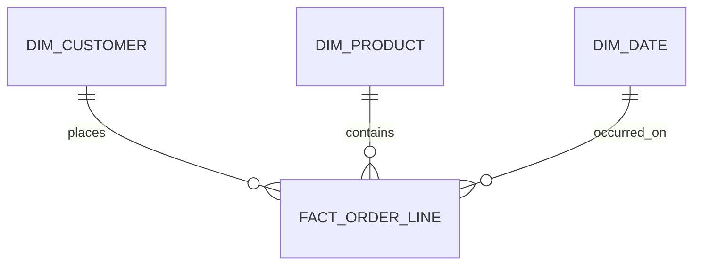

# Data Modeling: State the Grain First

## Topic explanation

The grain defines what one fact row represents. Dimensions provide descriptive context; facts provide additive or semi-additive measurements. Keys, late-arriving data, unknown members, and history rules must be explicit. A model that cannot answer its target questions simply is not “normalized” or “denormalized” correctly—it is misfit.

**Analogy:** Grain is the unit printed on a measuring cup. Mixing “one order” with “one order line” in a fact table is like combining liters and individual bottles without a conversion rule.



## Solved practical example

Order `o1` has two lines: two books at $10 and one pen at $3. At one-row-per-order-line grain, the fact table has two rows with revenues 20 and 3, both referencing the same customer/date dimension keys but different product keys. Customer and product names live in dimensions, not facts. Summing `line_revenue` correctly returns the $23 order total.

## Code exercise

Implement `build_star_schema(order_lines)`. Create deterministic surrogate keys, three dimensions, and a fact table at **one row per order line**. Repeated customer/product attributes must not be copied into facts. Preserve an unknown member for missing customer identifiers (IDs).

### Homework contract

Return a dictionary with `fact_order_line`, `dim_customer`, `dim_product`, and `dim_date`. Dimension rows contain their descriptive attributes and a deterministic surrogate key. Facts retain `order_id`, `line_id`, numeric measures, and the three dimension keys; they must not contain `customer_name` or `product_name`. Calculate `line_revenue = qty * unit_price`.

The same logical input in a different order must produce the same keys and rows. Missing customer identifiers map to exactly one “Unknown” customer member rather than producing a null foreign key or multiple unknown rows.

### Example input and expected output

```python
rows = [{
    "order_id": "o9",
    "line_id": 1,
    "date": "2026-02-01",
    "customer_id": None,
    "customer_name": None,
    "product_id": "p7",
    "product_name": "Cable",
    "qty": 2,
    "unit_price": 6,
}]
model = build_star_schema(rows)
```

Expected properties:

```python
len(model["fact_order_line"]) == 1
model["fact_order_line"][0]["line_revenue"] == 12
model["fact_order_line"][0]["customer_sk"] == model["dim_customer"][0]["customer_sk"]
model["dim_customer"][0]["customer_name"] == "Unknown"
model["dim_product"][0]["product_name"] == "Cable"
```

The numeric surrogate-key values are your design choice; determinism and relationships are the contract.

## Artificial Intelligence (AI) review

Use `AI_REVIEW_PROMPT.md`; explain additive measures and how the model handles late-arriving dimensions.

## Unit test

```bash
pytest basics/04-data-modeling/tests -q
```
