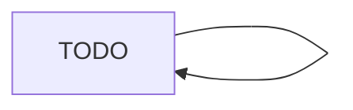

# Production system deep dive

## Opening answer
TODO

## Architecture

## Scale, capacity, service-level objective (SLO), and cost
TODO

## Failure and recovery
TODO

## Alternatives and stakeholder decision
TODO

## My contribution
TODO

## Question map
TODO
