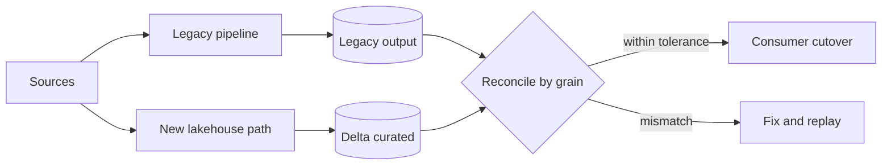

# Data Architecture: Lakehouse Migration Without a Big Bang

## Topic explanation

A safe migration has measurable equivalence, replayable history, bounded dual running, ownership, and rollback. Separate data-plane movement from consumer cutover. Define reconciliation at business grain; row counts alone miss duplicated, swapped, or semantically changed data.

**Analogy:** Migration is replacing a bridge while traffic continues. A temporary parallel bridge and traffic measurements cost money, but less than discovering structural weakness after demolition.



## Solved practical example

For 12 terabytes (TB) of history and 300 gigabytes per day (GB/day), use four gated phases: (1) backfill immutable raw data and reconcile counts, sums, distinct business keys, and sampled hashes; (2) dual-run seven days; (3) move two low-risk consumers behind a reversible view; (4) cut over after seven consecutive matching runs. Retain the legacy output for 14 days as rollback. A 0.01% row-count tolerance alone is insufficient because equal counts can contain different orders.

## Code exercise

Implement `migration_plan(requirements)`. Produce ordered phases with exit criteria, backfill strategy, dual-run duration, reconciliation checks, cutover, rollback, security controls, and rough monthly cost. Reject impossible recovery point objective (RPO)/recovery time objective (RTO) combinations rather than hiding them.

## Artificial Intelligence (AI) review

Use `AI_REVIEW_PROMPT.md`; defend Databricks/Snowflake boundaries and how you prevent endless dual running.

## Unit test

```bash
pytest intermediate/01-data-architecture/tests -q
```
