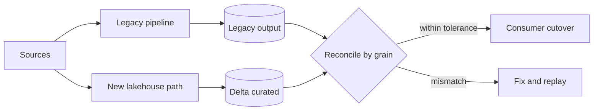

# Data Architecture: Lakehouse Migration Without a Big Bang

## Topic explanation

A safe migration has measurable equivalence, replayable history, bounded dual running, ownership, and rollback. Separate data-plane movement from consumer cutover. Define reconciliation at business grain; row counts alone miss duplicated, swapped, or semantically changed data.



## Practical example and analogy

Migration is replacing a bridge while traffic continues. A temporary parallel bridge and traffic measurements are expensive, but far cheaper than discovering structural weakness after demolition.

## Code exercise

Implement `migration_plan(requirements)`. Produce ordered phases with exit criteria, backfill strategy, dual-run duration, reconciliation checks, cutover, rollback, security controls, and rough monthly cost. Reject impossible RPO/RTO combinations rather than hiding them.

## AI review

Use `AI_REVIEW_PROMPT.md`; defend Databricks/Snowflake boundaries and how you prevent endless dual running.

## Unit test

```bash
pytest intermediate/01-data-architecture/tests -q
```
