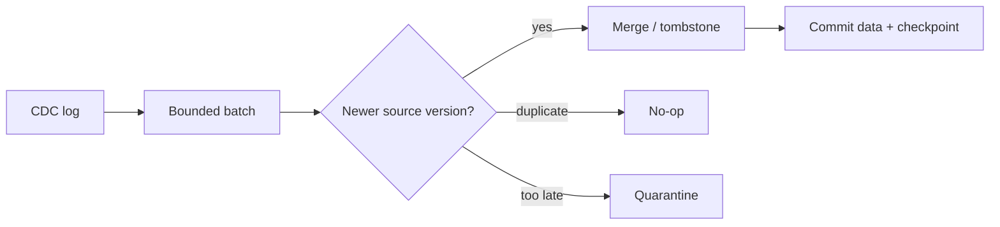

# Processing and Orchestration: CDC, Watermarks, and Backfills

## Topic explanation

CDC streams contain inserts, updates, deletes, duplicates, and out-of-order delivery. Correct application requires a source ordering key, tombstone policy, durable checkpoint, and rules for events older than retained state. Airflow schedules bounded work; Spark performs parallel state changes. Neither makes semantics automatic.



## Practical example and analogy

CDC is editing a shared document from delayed mail. The postmark—not arrival order—determines which edit is newer, and a deletion is still an edit that must be remembered.

## Code exercise

Implement `apply_cdc(snapshot, events, checkpoint)`. Order by `(source_lsn, event_id)`, ignore exact replays, apply deletes, quarantine events at or below the checkpoint that conflict with current state, and advance the checkpoint only to committed input.

## AI review

Use `AI_REVIEW_PROMPT.md`; defend atomicity between data and checkpoint, plus backfill isolation.

## Unit test

```bash
pytest intermediate/03-processing-and-orchestration/tests -q
```
