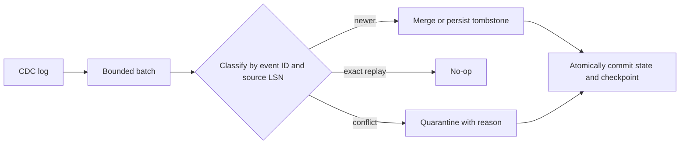

# Processing and Orchestration: Change Data Capture (CDC), Watermarks, and Backfills

## Topic explanation

CDC streams contain inserts, updates, deletes, duplicates, and out-of-order delivery. Correct application requires a source ordering key, tombstone policy, durable checkpoint, and rules for events older than retained state. Airflow schedules bounded work; Spark performs parallel state changes. Neither makes semantics automatic.

**Analogy:** CDC resembles editing a shared document through delayed mail. The postmark—not arrival order—determines which edit is newer, and a deletion is still an edit that must be remembered.



## Solved practical example

Snapshot `a=1` is at log sequence number (LSN) 5. The batch arrives as delete `a` at LSN 8, update `a=7` at LSN 7, and insert `b=2` at LSN 6. Sort by source LSN, apply 6 then 7 then 8, and commit snapshot `{b: 2}` with checkpoint 8 atomically. If the worker crashes before commit, replay all three; after commit, checkpoint 8 makes the replay a no-op.

## Code exercise

Implement `apply_cdc(snapshot, events, checkpoint)`. Order by `(source_lsn, event_id)`, ignore exact replays, apply deletes, quarantine events at or below the checkpoint that conflict with current state, and advance the checkpoint only to committed input.

### Homework contract

`snapshot` initially maps entity identifiers to current rows and stores the applied log sequence number (LSN) in `_lsn`. It may also be the durable `state` returned by a prior call. Events contain `event_id`, `id`, `op`, and `source_lsn`; upserts also contain payload fields. Return `snapshot`, `tombstones`, `state`, `checkpoint`, and `quarantined` without mutating either input.

Sort events by source position and stable event identifier. An upsert replaces the entity and records its `_lsn`; a delete removes it and persists a tombstone containing its LSN and event identifier. Persist processed-event fingerprints in the durable state: an exact duplicate is one operation, while reusing an `event_id` for a different payload is quarantined. Inputs above the checkpoint may advance the returned checkpoint only after their state change is accepted or deterministically quarantined. An event at or below the checkpoint is either an exact no-op replay or a conflicting late event that must be quarantined with a reason. Pass `result["state"]`, not only the visible snapshot, into the next call so deletes cannot be replayed or resurrected by stale events.

### Example input and expected output

```python
snapshot = {"a": {"id": "a", "value": 2, "_lsn": 4}}
events = [
    {"event_id": "e6", "id": "a", "op": "delete", "source_lsn": 6},
    {"event_id": "e5", "id": "b", "op": "upsert", "value": 9, "source_lsn": 5},
]
result = apply_cdc(snapshot, events, checkpoint=4)
```

Expected result:

```python
result["snapshot"] == {"b": {"id": "b", "value": 9, "_lsn": 5, "_event_id": "e5"}}
result["tombstones"] == {"a": {"_lsn": 6, "_event_id": "e6"}}
result["checkpoint"] == 6
result["quarantined"] == []
result["state"]["records"] == result["snapshot"]
result["state"]["checkpoint"] == 6
```

The function receives events out of order, so array position must not determine the result. A later call must use `apply_cdc(result["state"], next_events, result["checkpoint"])`; passing only `result["snapshot"]` discards deletion history.

## Artificial Intelligence (AI) review

Use `AI_REVIEW_PROMPT.md`; defend atomicity between data and checkpoint, plus backfill isolation.

## Unit test

```bash
pytest intermediate/03-processing-and-orchestration/tests -q
```
