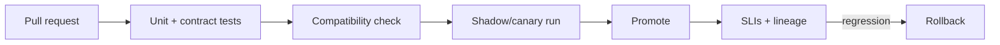

# DataOps: Deploy and Observe Data Products

## Topic explanation

Continuous integration and continuous delivery (CI/CD) for data validates code, contracts, representative data, backward compatibility, and deployment safety. Runtime observability connects freshness, volume, quality, cost, and lineage to consumer impact. Alerts need an owner and action; otherwise they become background noise.

**Analogy:** Deploying a data model is changing a public road: unit tests inspect the asphalt, compatibility checks protect vehicle widths, and a canary opens one lane before redirecting all traffic.



## Solved practical example

A pull request adds a nullable column used by no current consumer. Unit and contract tests pass, lineage review identifies Finance as a critical downstream owner, and a 5% canary shows no freshness or error regression. Approve with Finance acknowledgement, deploy 5% → 25% → 100%, and roll back if error rate rises more than 1% or freshness exceeds the service-level objective (SLO). Removing an existing column without a migration window would be blocked before the canary.

## Code exercise

Implement `deployment_decision(change, evidence)`. Block breaking schema changes without a migration window, failed tests, unresolved critical lineage impact, and excessive canary regressions. Return reasons, required approvals, rollout steps, and rollback trigger.

## Artificial Intelligence (AI) review

Use `AI_REVIEW_PROMPT.md`; defend which checks belong in CI versus runtime.

## Unit test

```bash
pytest intermediate/05-dataops/tests -q
```
