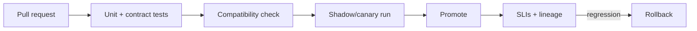

# DataOps: Deploy and Observe Data Products

## Topic explanation

Data CI/CD validates code, contracts, representative data, backward compatibility, and deployment safety. Runtime observability connects freshness, volume, quality, cost, and lineage to consumer impact. Alerts need an owner and action; otherwise they become background noise.



## Practical example and analogy

Deploying a data model is changing a public road: unit tests inspect the asphalt, compatibility checks protect vehicle widths, and a canary opens one lane before redirecting all traffic.

## Code exercise

Implement `deployment_decision(change, evidence)`. Block breaking schema changes without a migration window, failed tests, unresolved critical lineage impact, and excessive canary regressions. Return reasons, required approvals, rollout steps, and rollback trigger.

## AI review

Use `AI_REVIEW_PROMPT.md`; defend which checks belong in CI versus runtime.

## Unit test

```bash
pytest intermediate/05-dataops/tests -q
```
