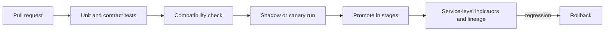

# DataOps: Deploy and Observe Data Products

## Topic explanation

Continuous integration and continuous delivery (CI/CD) for data validates code, contracts, representative data, backward compatibility, and deployment safety. Runtime observability connects freshness, volume, quality, cost, and lineage to consumer impact. Alerts need an owner and action; otherwise they become background noise.

**Analogy:** Deploying a data model is changing a public road: unit tests inspect the asphalt, compatibility checks protect vehicle widths, and a canary opens one lane before redirecting all traffic.



## Solved practical example

A pull request adds a nullable column used by no current consumer. Unit and contract tests pass, lineage review identifies Finance as a critical downstream owner, and a 5% canary shows no freshness or error regression. Approve with Finance acknowledgement, deploy 5% → 25% → 100%, and roll back if error rate rises more than 1% or freshness exceeds the service-level objective (SLO). Removing an existing column without a migration window would be blocked before the canary.

## Code exercise

Implement `deployment_decision(change, evidence)`. Block breaking schema changes without a migration window, failed tests, unresolved critical lineage impact, and excessive canary regressions. Return reasons, required approvals, rollout steps, and rollback trigger.

### Homework contract

`change` describes whether the change is breaking, its migration window, privacy impact, and critical downstream consumers. `evidence` contains test, lineage, and canary results. Return `deploy`, `reasons`, `required_approvals`, `rollout_steps`, and `rollback_trigger`.

Accumulate every blocking reason rather than returning after the first failure; reviewers need the complete decision. A nonbreaking change with passing evidence can deploy through at least three stages. Critical consumer owners must appear in approvals. A breaking change without a migration window or a material canary regression must set `deploy` to false even when unit tests pass.

Treat a missing, nonnumeric, infinite, or not-a-number canary delta as invalid evidence and block the deployment; invalid telemetry is not proof of safety.

### Example input and expected output

```python
change = {
    "breaking": False,
    "pii": True,
    "downstream_critical": ["risk_dashboard"],
}
evidence = {
    "tests_passed": True,
    "lineage_reviewed": True,
    "canary_error_delta": 0.002,
}
```

Expected properties:

```python
result["deploy"] is True
"risk_dashboard" in " ".join(result["required_approvals"])
len(result["rollout_steps"]) >= 3
bool(result["rollback_trigger"]) is True
```

If `breaking` becomes true without `migration_window`, or the error delta becomes `0.2`, the output must block deployment and explain both conditions when both apply.

## Artificial Intelligence (AI) review

Use `AI_REVIEW_PROMPT.md`; defend which checks belong in CI versus runtime.

## Unit test

```bash
pytest intermediate/05-dataops/tests -q
```
