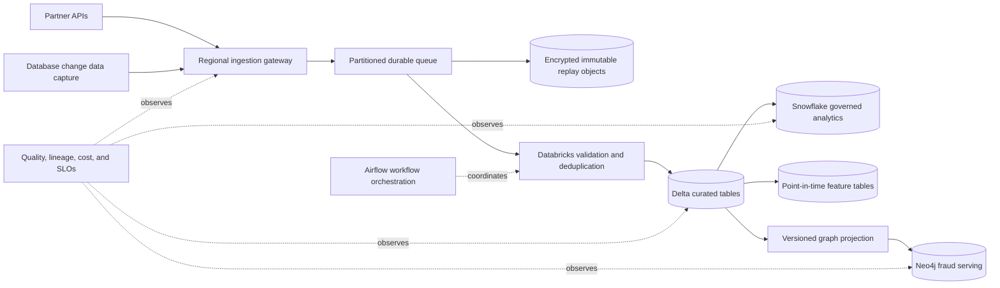

# Intelligent Commerce Data Platform — Reference Design

## Requirements and assumptions

The platform receives partner application programming interface (API) events and database change data capture (CDC) for a Latin America and United States retailer. The stated peak is 250,000 events per second. It must support 15-minute analytical freshness, sub-second fraud traversals, point-in-time machine-learning features, 99.9% availability, 30 days of replay, European Union residency, personally identifiable information controls, service-level objectives (SLOs), and bounded cost.

I assume an average payload of 1.5 kilobytes, an average rate equal to 35% of peak, and a three-times daily compaction factor from raw JavaScript Object Notation into compressed columnar data. At 87,500 average events per second, raw ingress is about 11.3 billion events or 17 terabytes per day before protocol overhead. Thirty-day raw replay is approximately 510 terabytes uncompressed; compression and lifecycle measurements, not this estimate alone, drive the final storage reservation. Capacity is provisioned for the 250,000 peak plus 30% headroom, or 325,000 events per second. Load tests must include skew by tenant and a burst longer than the queue-retention safety margin.

Recovery point objective (RPO) and recovery time objective (RTO) are separate from freshness. I propose a 5-minute RPO for accepted ingestion and a 60-minute RTO for curated analytics. Fraud serving has a 1-minute RPO and a 15-minute RTO within an approved region. These are design proposals that require business approval.

## Architecture



The data plane is regional. European Union tenant payloads, raw objects, queues, checkpoints, encryption keys, curated tables, graph projections, logs containing payload data, and backups remain in approved European Union regions. A global control plane may hold tenant identifiers, deployment versions, and policy metadata only after Security confirms those fields are not restricted payload. A full regional failure uses a second approved region, not an availability zone in the failed region and not a United States fallback.

## Ingestion and processing correctness

The gateway authenticates producers, enforces tenant quotas and schemas, assigns an ingestion identifier, and writes to a durable partitioned queue. Partition keys combine tenant and a stable business key so one entity is ordered without sending a large tenant to one partition. Hot tenants receive additional deterministic buckets when ordering requirements allow it.

Every raw object has a manifest containing source range, object checksum, schema version, encryption-key version, and writer identifier. Databricks jobs consume bounded offset ranges. They validate required fields, quarantine malformed events, normalize types, and deduplicate by stable event identifier. Source-version ordering resolves updates; ingestion time never substitutes for source order. Tombstones remove current state but remain in audit history.

Publication writes data and a commit record containing offset range, input hash, output partitions, and code version. A retry checks that record before writing. This provides an effectively exactly-once curated result even though raw delivery can be at least once. Ambiguous sink timeouts are resolved by reading the commit record, not by assuming failure.

Airflow coordinates dependencies, retries, backfills, and ownership. Business transformations remain in tested Python or Structured Query Language modules rather than being hidden in workflow definitions. Backfills use separate pools and output branches, reconcile at business grain, and promote through a metadata switch.

## Storage and modeling

Raw replay data uses encrypted object storage partitioned by region, ingestion date, and bounded tenant bucket. Thirty days remain immediately replayable; later retention follows legal and audit requirements. Small objects are compacted without deleting the source until checksum and count reconciliation succeeds.

Delta curated tables use liquid clustering for new large tables when Databricks workload evidence supports it. Liquid clustering is not combined with legacy partitioning or `ZORDER`. Target file size begins around 512 megabytes and is tuned from files scanned, bytes read, task count, 95th-percentile latency, update amplification, and optimization cost.

Snowflake receives governed analytical models rather than every raw payload. Dimensional facts declare grain explicitly. Customer attributes that require history use slowly changing dimension Type 2 with nonoverlapping half-open intervals. Late facts join dimensions as of event time. Workload-specific warehouses isolate Finance, ad hoc analysis, and automated extracts. Resource monitors, query tags, pruning metrics, and owner-level budgets control spend.

Neo4j is a projection for multi-hop account, device, card, and network relationships. It is not the analytical source of truth. Every projection records the Delta snapshot version and transformation version. Projection lag, node and edge counts, sampled neighborhood hashes, and orphan rates are checked before promotion. Aggregate scans stay in Delta or Snowflake.

Feature tables are materialized with event-time and knowledge-time cutoffs. An event qualifies only if it occurred before the label and was available to the system before the label. Every row includes feature-definition version, source snapshot, time window, and deterministic hash. Offline training and online serving share definitions and are monitored for skew.

## Security and privacy

Transport and storage are encrypted with region-scoped managed keys. Roles are least privilege, short lived where possible, and separated for ingestion, transformation, serving, and break-glass administration. Key use, policy changes, exports, and privileged queries are audited.

Raw email is restricted to the minimal protected layer. Downstream equality joins use a deterministic Keyed-Hash Message Authentication Code pseudonym over a normalized address. The secret is stored in a managed key service, not source code or workflow variables. The token includes a key version so rotation can dual-read old and new values during migration. This is pseudonymization, not encryption or anonymization: equality is visible, key compromise permits guessing attacks, and the value remains personal data. Nonproduction uses synthetic or masked data.

Deletion requests are tracked as durable workflows across raw-retention exceptions, curated tables, Snowflake models, features, graph projections, caches, and backups according to legal policy. Completion produces auditable evidence. Residency policy is enforced in infrastructure, catalog permissions, deployment tests, and failover exercises rather than documentation alone.

## Reliability, observability, and recovery

Service-level indicators include accepted-ingestion lag, curated freshness, valid-event rate, reconciliation mismatches, graph-projection lag, feature availability, query latency, and consumer-visible correctness. A 99.9% monthly objective allows about 43.2 bad minutes in a 30-day month. Error-budget consumption controls risky releases; burn rate is calculated over explicit short and long windows rather than confused with the percentage of monthly budget consumed.

Alerts contain owner, affected tenant and asset, critical downstream lineage, last verified checkpoint, runbook, and recommended action. A high reject rate stops publication while raw evidence continues landing. Queues absorb short downstream failures; rate limits and per-tenant quotas prevent a noisy neighbor from exhausting shared capacity.

Recovery exercises cover worker loss, poison records, queue replay, corrupt publication, encryption-key unavailability, availability-zone failure, full regional loss, Snowflake load duplication, graph projection drift, and ambiguous timeout after commit. Restoration is not complete until counts, keys, amounts, null rates, and sampled hashes match and critical consumers approve.

## Deployment, migration, and rollback

Phase 1 provisions regional foundations, policies, keys, queues, raw manifests, and observability. Exit requires capacity and residency tests. Phase 2 backfills immutable history into Delta and reconciles at business grain. Phase 3 dual-runs current data for at least 7 consecutive clean days. Phase 4 moves low-risk analytical consumers through a reversible view, then Finance, features, and fraud serving independently.

Every phase has an owner, budget, exit criteria, and rollback. Analytical rollback switches the governed view to the prior model version. Processing rollback restores the previous code and replays from the last verified offset into isolated output. Graph rollback selects the prior projection checkpoint. No rollback overwrites raw evidence.

Continuous integration checks unit behavior, contracts, deterministic fixtures, security rules, and backward compatibility. Deployment uses shadow output followed by 5%, 25%, and 100% promotion. It stops on correctness mismatch, freshness breach, unexpected cost increase above 15%, or critical-consumer rejection.

## Cost controls

Major cost drivers are queue retention, raw object volume, Databricks compute, Delta optimization, Snowflake credits, graph capacity, cross-region replication, and observability cardinality. Every workload carries tenant, product, environment, and owner tags. Autoscaling has minimums, maximums, and queue-based targets. Backfills use discounted capacity only when interruption is safe. Snowflake warehouses auto-suspend and have resource monitors. Graph history is bounded because reproducible versions remain in the analytical source.

The first estimate must show ranges rather than false precision. I would validate bytes per event, compression, average versus peak rate, query concurrency, graph working set, and replication policy with a one-week production sample. A monthly cost review compares cost per million accepted events and cost per critical query, not only total spend.

## Rejected alternatives and open decisions

I reject one global data plane because it makes residency and failure isolation unsafe. I reject Snowflake as the only raw replay store because object storage is cheaper and decouples recovery from warehouse availability. I reject Neo4j as the analytical source of truth because large aggregate scans do not benefit from graph traversal. I reject streaming every transformation: 15-minute analytics can often use less expensive bounded micro-batches, while fraud and ingestion remain streaming.

Open decisions requiring measured evidence include queue technology, regional cloud services, exact graph topology, Delta clustering keys, Snowflake warehouse sizes, and whether some tenants require dedicated accounts. The design is complete enough to test those decisions without pretending product names replace workload evidence.

## Validation evidence

Before approval I would attach capacity-test results at 325,000 events per second, reconciliation output for a representative backfill, a key-rotation exercise, an availability-zone and regional-failure drill, graph-projection comparison, point-in-time feature leakage tests, and cost estimates with assumptions. The final production-readiness review requires Security, Finance, platform operations, and named consumer owners to accept the remaining risks.

The reference implementation was verified with the repository test harness:

```text
STUDY_USE_SOLUTIONS=1 python -m pytest advanced/08-capstone-mock-interview/tests -q
...                                                                      [100%]
3 passed
```
