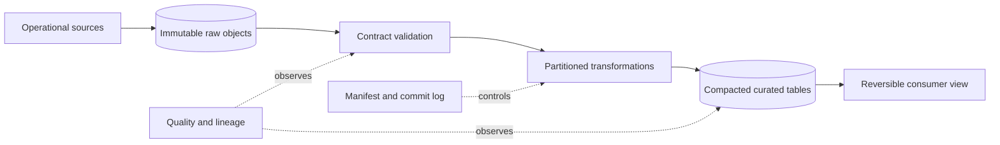

# Production System Deep Dive

> Illustrative structure only. Never present this fictional project as personal experience; replace it with facts you can defend truthfully.

## Opening answer

I redesigned a daily customer-events pipeline that had become both slow and unreliable as volume grew. The system processed 3.2 terabytes per day for 42 internal consumers. Its 95th-percentile completion time was 4.2 hours against a two-hour service-level objective (SLO), and it caused 9 data incidents in the previous quarter. I owned the performance investigation, target design, migration gates, and production rollout. Profiling showed a 40-times tenant-key skew, 18 million small files, and retries that recomputed already committed partitions. I introduced deterministic manifests, selective key salting, file compaction, and a reversible consumer view. After a 14-day dual run, the 95th percentile fell to 71 minutes, compute cost fell 18%, and the following quarter had 0 duplicate-publication incidents.

## Architecture

The raw layer retained source objects and checksums for 30 days. A batch manifest identified every input object, transformation version, output partition, and expected aggregate. Workers wrote to isolated staging paths. Publication atomically replaced the target partition and recorded the manifest identifier. The consumer view separated physical publication from cutover, so rollback changed metadata instead of rewriting 3.2 terabytes.

## Scale, capacity, service-level objective, and cost

Average input was about 37 megabytes per second, but the six-hour arrival window produced a measured peak near 150 megabytes per second. I designed for a two-times burst plus 25% headroom, or roughly 375 megabytes per second through validation. The largest tenant represented 28% of events, which explained why adding uniform compute had produced little improvement.

The freshness SLO was 120 minutes at the 95th percentile. We defined a 30-minute recovery point objective for committed source manifests and a 90-minute recovery time objective for the curated layer. Monthly compute had been approximately $84,000. The redesign initially added $9,000 for the dual run and compaction jobs, but steady-state compute fell to about $69,000 because fewer tasks opened tiny files and skewed joins stopped holding the cluster open. Storage rose 6% because raw retention was lengthened, a trade-off Finance accepted for reliable replay.

## Failure and recovery

During the dual run, one executor timed out after writing a partition but before acknowledging success. The orchestrator retried the batch. The commit log showed the same manifest was already published, so the retry verified the output checksum and exited without appending duplicate rows. The alert included the affected partition, manifest, consumer lineage, and runbook link. We kept the old view active, repaired the executor configuration, replayed from the last verified manifest, and compared row counts, distinct business keys, sums by currency, null rates, and sampled hashes before resuming cutover.

My mistake was initially describing the pipeline as “exactly once.” The raw audit copy was at-least-once and the curated result was effectively exactly once only because publication and manifest checks were idempotent. I corrected that statement in the design review and added fault-injection cases for a crash before write, after write, and after commit.

## Alternatives and stakeholder decision

The first alternative was doubling the cluster. I rejected it because stage-level metrics showed skew and file-open overhead, not uniform central processing unit saturation. The second was repartitioning every tenant with random salt. I rejected it because most tenants were balanced and universal salting would enlarge data and complicate downstream joins. We salted only the three largest tenants and recorded the salt count as versioned configuration.

Operations wanted an immediate cutover to stop supporting the legacy path; Finance wanted a full month of parallel results. I proposed a 14-day dual run with seven consecutive clean daily reconciliations, followed by two low-risk consumers and then Finance. That bounded the temporary cost while giving Finance explicit evidence and a one-command rollback through the view.

## My contribution

I designed the manifest and publication protocol, wrote the profiling queries, implemented the selective salting transform, and defined the reconciliation gates. Two platform engineers changed cluster policies and observability, while a data analyst validated Finance totals. I led the failure review, but I did not write the storage compactor. Being explicit about those boundaries prevents the project from sounding like uncheckable team-level ownership.

## Question map

- “40-times skew” → measurement method, hot-key detection, salting correctness, and join reconstruction.
- “Deterministic manifest” → retry boundaries, ambiguous timeouts, checksums, and atomic publication.
- “18 million files” → file sizing, compaction concurrency, partition choice, and optimization cost.
- “$69,000 steady state” → attribution, dual-run cost, storage trade-off, and evidence quality.
- “Seven clean runs” → reconciliation grain, tolerance, late data, and rollback trigger.
- “My mistake” → delivery guarantees, incident communication, and what I would design first now.
